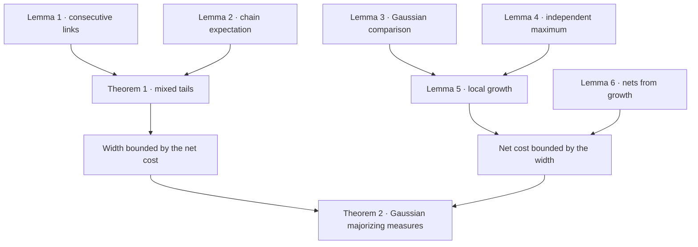

# Finite generic chaining in Lean

GPT-Sol 6.2, prompted by Victor Chernozhukov.

Suppose we use the largest of $p$ standardized estimation errors to construct simultaneous confidence bounds. If all the errors equal one standard Gaussian, adding another copy leaves the maximum unchanged. If they are independent standard Gaussians, the expected maximum grows on the order of $\sqrt{\log p}$. The two families have the same marginal distributions. What distinguishes them is the size of their increments. Generic chaining uses these increments to decide which coordinates can represent one another and how much each approximation costs.

For each result, the mathematical statement appears first. Open **Proof outline** to read the argument or **Lean statement** to see the type reported by Lean. The declaration name opens the full proof at the [checked revision](https://github.com/VC2015/generic-chaining/tree/b0db8f333413b3d0fc9e1e20825dc7bd4d7019fc). The **Uses** links identify selected supporting steps, including steps reached through intermediate lemmas.

| Result | Lean declaration |
|---|---|
| [Theorem 1 · Finite mixed-tail expectation bound](#theorem-1) | [`GenericChaining.dirksen_expectation`](https://github.com/VC2015/generic-chaining/blob/b0db8f333413b3d0fc9e1e20825dc7bd4d7019fc/GenericChaining/Dirksen.lean#L24) |
| [Theorem 2 · Finite Gaussian majorizing measures](#theorem-2) | [`GenericChaining.finite_gaussian_majorizing_measure`](https://github.com/VC2015/generic-chaining/blob/b0db8f333413b3d0fc9e1e20825dc7bd4d7019fc/GenericChaining/GaussianChaining.lean#L79) |
| [Lemma 1 · Consecutive representatives](#lemma-1) | [`GenericChaining.weighted_link_bound`](https://github.com/VC2015/generic-chaining/blob/b0db8f333413b3d0fc9e1e20825dc7bd4d7019fc/GenericChaining/Link.lean#L59) |
| [Lemma 2 · Expectation along a finite chain](#lemma-2) | [`GenericChaining.finite_chain_expectation`](https://github.com/VC2015/generic-chaining/blob/b0db8f333413b3d0fc9e1e20825dc7bd4d7019fc/GenericChaining/ChainingExpectation.lean#L128) |
| [Lemma 3 · Sudakov–Fernique comparison](#lemma-3) | [`GenericChaining.gaussianWidth_mono_of_increment_le`](https://github.com/VC2015/generic-chaining/blob/b0db8f333413b3d0fc9e1e20825dc7bd4d7019fc/GenericChaining/GaussianComparison.lean#L276) |
| [Lemma 4 · Independent Gaussian maximum](#lemma-4) | [`GenericChaining.standardGaussian_iid_max_explicit_lower_bound`](https://github.com/VC2015/generic-chaining/blob/b0db8f333413b3d0fc9e1e20825dc7bd4d7019fc/GenericChaining/GaussianMinoration.lean#L319) |
| [Lemma 5 · Local Gaussian growth](#lemma-5) | [`GenericChaining.gaussian_local_growth`](https://github.com/VC2015/generic-chaining/blob/b0db8f333413b3d0fc9e1e20825dc7bd4d7019fc/GenericChaining/GaussianLocalGrowth.lean#L206) |
| [Lemma 6 · Local growth controls the net cost](#lemma-6) | [`GenericChaining.gamma2_le_of_localGrowth_exact`](https://github.com/VC2015/generic-chaining/blob/b0db8f333413b3d0fc9e1e20825dc7bd4d7019fc/GenericChaining/GrowthChaining.lean#L52) |
| [Lemma 7 · Discrete exponential-tail cost](#lemma-7) | [`GenericChaining.gamma1_discrete_le_log2`](https://github.com/VC2015/generic-chaining/blob/b0db8f333413b3d0fc9e1e20825dc7bd4d7019fc/GenericChaining/Discrete.lean#L58) |

<details>
<summary>Proof dependencies for the two main theorems</summary>

An arrow points from a supporting result to the conclusion that uses it. The Gaussian theorem has two branches because its two inequalities have different proofs.



</details>

## Notation

Throughout, $T$ is finite and nonempty. Write $M_0=1$ and $M_k=2^{2^k}$ for $k\ge1$. A sequence of nonempty nets $N_k\subseteq T$ is admissible if $|N_k|\le M_k$. For $\alpha=1,2$ define

$$
\gamma_\alpha(T,d)=\inf_{(N_k)\ {\mathrm{admissible}}}\max_{t\in T}\sum_{k\ge0}2^{k/\alpha}d(t,N_k),\qquad d(t,N_k)=\min_{s\in N_k}d(t,s).
$$

The distance $d$ may vanish at distinct indices. For the mixed-tail results write $w_k(s,t)=2^k d_1(s,t)+2^{k/2}d_2(s,t)$. For $a:T\to\mathbb{R}^r$ and $G\sim N(0,I_r)$, write $W(a)=\mathbb{E}\max_t\langle G,a_t\rangle$ and $d_a(s,t)=\|a_s-a_t\|_2$. The width uses the one-sided maximum.

## Theorem 1

**Finite mixed-tail expectation bound.** Bernstein’s inequality gives two scales for an increment. The next theorem lets each scale contribute its own cost to the expected maximum.

Let $(X_t)_{t\in T}$ be real random variables on a probability space with integrable pairwise increments. Suppose finite pseudometrics $d_1,d_2$ satisfy, for every $s,t\in T$ and $u>0$,

$$
\mathbb{P}\{|X_s-X_t|>\sqrt u\,d_2(s,t)+u\,d_1(s,t)\}\le2e^{-u}.
$$

Then for each $t_0\in T$,

$$
\mathbb{E}\max_t|X_t-X_{t_0}|
 \le48\{\gamma_2(T,d_2)+\gamma_1(T,d_1)\}
 +2\max_t\mathbb{E}|X_t-X_{t_0}|.
$$

**Lean.** [`GenericChaining.dirksen_expectation`](https://github.com/VC2015/generic-chaining/blob/b0db8f333413b3d0fc9e1e20825dc7bd4d7019fc/GenericChaining/Dirksen.lean#L24)

**Uses.** [Lemma 1](#lemma-1), [Lemma 2](#lemma-2), [common representatives](https://github.com/VC2015/generic-chaining/blob/b0db8f333413b3d0fc9e1e20825dc7bd4d7019fc/GenericChaining/ChainGeometry.lean#L38), [weighted path length](https://github.com/VC2015/generic-chaining/blob/b0db8f333413b3d0fc9e1e20825dc7bd4d7019fc/GenericChaining/ChainGeometry.lean#L155).

<details>
<summary>Proof outline</summary>

The proof has two parts. [Lemma 1](#lemma-1) lets us merge nets for $d_1$ and $d_2$ into paths whose weighted lengths cost at most six times the sum of the two net costs. [Lemma 2](#lemma-2) bounds the expected maximum along these paths by eight times their length. Their product gives $48$. At each level, group indices according to their two nearest representatives. In each group choose an index minimizing $e_k(t)=2^k d_1(t,N_{1k})+2^{k/2}d_2(t,N_{2k})$. The triangle inequalities give $w_k(t,r_k(t))\le2e_k(t)$. There are at most $M_k^2$ groups. Take the fine nets to be all of $T$ and terminate each path at its own index. Changing the root $a$ to $t_0$ costs at most $\mathbb{E}|X_a-X_{t_0}|$. Let the net costs decrease to their infima.

</details>

<details>
<summary>Lean statement</summary>

The complete proof is in [`GenericChaining.dirksen_expectation`](https://github.com/VC2015/generic-chaining/blob/b0db8f333413b3d0fc9e1e20825dc7bd4d7019fc/GenericChaining/Dirksen.lean#L24).

```lean
GenericChaining.dirksen_expectation.{u_1, u_2} {T : Type u_1} {Ω : Type u_2} [Fintype T] [Nonempty T]
  [MeasurableSpace Ω] {μ : MeasureTheory.Measure Ω} [MeasureTheory.IsProbabilityMeasure μ] (X : T → Ω → ℝ)
  (d₁ d₂ : T → T → NNReal) (diag₁ : ∀ (t : T), d₁ t t = 0) (diag₂ : ∀ (t : T), d₂ t t = 0)
  (symm₁ : ∀ (s t : T), d₁ s t = d₁ t s) (symm₂ : ∀ (s t : T), d₂ s t = d₂ t s)
  (tri₁ : ∀ (s t c : T), d₁ s t ≤ d₁ s c + d₁ t c) (tri₂ : ∀ (s t c : T), d₂ s t ≤ d₂ s c + d₂ t c)
  (htail : GenericChaining.HasMixedTail μ X d₁ d₂)
  (hInt : ∀ (s t : T), MeasureTheory.Integrable (fun ω => X s ω - X t ω) μ) (t₀ : T) :
  ∫ (ω : Ω), GenericChaining.incrementMaximum X t₀ ω ∂μ ≤
    GenericChaining.dirksenConstant *
        ((GenericChaining.gamma2 fun s t => ↑(d₂ s t)).toReal + (GenericChaining.gamma1 fun s t => ↑(d₁ s t)).toReal) +
      2 * ⨆ t, ∫ (ω : Ω), |X t ω - X t₀ ω| ∂μ
```

</details>

## Lemma 1

**Consecutive representatives.** Two nets can assign different representatives to the same $t$. To telescope the increments along one path we must bound the cost of passing between successive representatives.

For finite pseudometrics $d_1,d_2$, let $t,p,q\in T$, $k\ge0$, and $e,f\in\mathbb{R}$. If $w_k(t,p)\le2e$ and $w_{k+1}(t,q)\le2f$, then

$$
w_{k+1}(p,q)\le4e+2f .
$$

**Lean.** [`GenericChaining.weighted_link_bound`](https://github.com/VC2015/generic-chaining/blob/b0db8f333413b3d0fc9e1e20825dc7bd4d7019fc/GenericChaining/Link.lean#L59)

**Uses.** The two triangle inequalities and $\sqrt2\le2$.

<details>
<summary>Proof outline</summary>

Apply the triangle inequality through $t$. The contribution of the previous representative is at most $w_{k+1}(p,t)\le 2w_k(p,t)\le4e$. The next representative contributes at most $2f$.

</details>

<details>
<summary>Lean statement</summary>

The complete proof is in [`GenericChaining.weighted_link_bound`](https://github.com/VC2015/generic-chaining/blob/b0db8f333413b3d0fc9e1e20825dc7bd4d7019fc/GenericChaining/Link.lean#L59).

```lean
GenericChaining.weighted_link_bound.{u_1} {T : Type u_1} (d₁ d₂ : T → T → NNReal)
  (tri₁ : ∀ (s t c : T), d₁ s t ≤ d₁ s c + d₁ t c) (tri₂ : ∀ (s t c : T), d₂ s t ≤ d₂ s c + d₂ t c)
  (symm₁ : ∀ (s t : T), d₁ s t = d₁ t s) (symm₂ : ∀ (s t : T), d₂ s t = d₂ t s) (k : ℕ) (t p q : T) (eprev enext : ℝ)
  (hprev : 2 ^ k * ↑(d₁ t p) + √2 ^ k * ↑(d₂ t p) ≤ 2 * eprev)
  (hnext : 2 ^ (k + 1) * ↑(d₁ t q) + √2 ^ (k + 1) * ↑(d₂ t q) ≤ 2 * enext) :
  2 ^ (k + 1) * ↑(d₁ p q) + √2 ^ (k + 1) * ↑(d₂ p q) ≤ 2 * enext + 4 * eprev
```

</details>

## Lemma 2

**Expectation along a finite chain.** Once the weighted length of every path is bounded, a single probability estimate controls the increments on all paths.

Under the mixed-tail and integrability hypotheses of [Theorem 1](#theorem-1), let $r_k:T\to T$ satisfy $|\operatorname{im}r_k|\le M_k^2$ for every $k\ge0$. Suppose $r_0(t)=a$ and $r_K(t)=t$ for all $t$, with $K\ge0$. If $B\ge0$ and
$\sum_{k=0}^{K-1}w_{k+1}(r_k(t),r_{k+1}(t))\le B$ for each $t$, then

$$
\mathbb{E}\max_t |X_t-X_a|\le8B .
$$

**Lean.** [`GenericChaining.finite_chain_expectation`](https://github.com/VC2015/generic-chaining/blob/b0db8f333413b3d0fc9e1e20825dc7bd4d7019fc/GenericChaining/ChainingExpectation.lean#L128)

**Uses.** [simultaneous tail bound](https://github.com/VC2015/generic-chaining/blob/b0db8f333413b3d0fc9e1e20825dc7bd4d7019fc/GenericChaining/ChainingExpectation.lean#L58), [tail integration](https://github.com/VC2015/generic-chaining/blob/b0db8f333413b3d0fc9e1e20825dc7bd4d7019fc/GenericChaining/TailExpectation.lean#L150).

<details>
<summary>Proof outline</summary>

At each level the number of distinct links is at most the product of the numbers of representatives at its endpoints. A union bound using the mixed-tail hypothesis therefore controls every link on that level. Summing the exceptional probabilities over levels gives, for $v\ge1$,

$$
\mathbb{P}\!\left\{\max_t|X_t-X_a|>(5+v)B\right\}
 \le \frac{2e^{-v}}{1-e^{-v}}.
$$

Indeed, whenever all links satisfy their bounds, their increments telescope from $a$ to $t$ for every $t$. Integration gives the factor eight. The same estimate holds at $B=0$ by taking a positive upper bound for the length and letting it decrease to zero.

</details>

<details>
<summary>Lean statement</summary>

The complete proof is in [`GenericChaining.finite_chain_expectation`](https://github.com/VC2015/generic-chaining/blob/b0db8f333413b3d0fc9e1e20825dc7bd4d7019fc/GenericChaining/ChainingExpectation.lean#L128).

```lean
GenericChaining.finite_chain_expectation.{u_1, u_2} {T : Type u_1} {Ω : Type u_2} [Fintype T] [Nonempty T]
  [MeasurableSpace Ω] {μ : MeasureTheory.Measure Ω} [MeasureTheory.IsProbabilityMeasure μ] [DecidableEq T]
  {X : T → Ω → ℝ} {d₁ d₂ : T → T → NNReal} (htail : GenericChaining.HasMixedTail μ X d₁ d₂)
  (hInt : ∀ (s t : T), MeasureTheory.Integrable (fun ω => X s ω - X t ω) μ) (r : ℕ → T → T) (K : ℕ) (t₀ : T)
  (hstart : ∀ (t : T), r 0 t = t₀) (hend : ∀ (t : T), r K t = t)
  (hcard : ∀ (k : ℕ), (Finset.image (r k) Finset.univ).card ≤ GenericChaining.capacity k ^ 2) {B : ℝ} (hB : 0 ≤ B)
  (hlength :
    ∀ (t : T),
      ∑ k ∈ Finset.range K, (2 ^ (k + 1) * ↑(d₁ (r k t) (r (k + 1) t)) + √2 ^ (k + 1) * ↑(d₂ (r k t) (r (k + 1) t))) ≤
        B) :
  ∫ (ω : Ω), GenericChaining.incrementMaximum X t₀ ω ∂μ ≤ GenericChaining.chainExpectationConstant * B
```

</details>

## Theorem 2

**Finite Gaussian majorizing measures.** For a Gaussian family, the standard deviation of an increment is its canonical distance. The next theorem determines, up to universal constants, how much this distance tells us about the expected maximum.

There exist $C_{\mathrm{L}},C_{\mathrm{U}}>0$ such that for every $r\ge0$, every finite nonempty $T$ and every $a:T\to\mathbb{R}^r$,

$$
\gamma_2(T,d_a)\le C_{\mathrm{L}} W(a),\qquad
 W(a)\le C_{\mathrm{U}}\gamma_2(T,d_a).
$$

One may take $C_{\mathrm{U}}=100$ and $C_{\mathrm{L}}=K_*/c_{\mathrm{g}}$, where $c_{\mathrm{g}}$ and $K_*$ are the constants used in [Lemma 5](#lemma-5) and [Lemma 6](#lemma-6).

The two directions have separate proofs. The bound on the width uses [Theorem 1](#theorem-1). The bound on the net cost uses [Lemma 5](#lemma-5) and [Lemma 6](#lemma-6).

**Lean.** [`GenericChaining.finite_gaussian_majorizing_measure`](https://github.com/VC2015/generic-chaining/blob/b0db8f333413b3d0fc9e1e20825dc7bd4d7019fc/GenericChaining/GaussianChaining.lean#L79) · [`GenericChaining.gamma2_le_gaussianWidth`](https://github.com/VC2015/generic-chaining/blob/b0db8f333413b3d0fc9e1e20825dc7bd4d7019fc/GenericChaining/GaussianChaining.lean#L28) · [`GenericChaining.gaussianWidth_le_gamma2`](https://github.com/VC2015/generic-chaining/blob/b0db8f333413b3d0fc9e1e20825dc7bd4d7019fc/GenericChaining/GaussianChaining.lean#L51)

**Uses.** [Theorem 1](#theorem-1), [Lemma 5](#lemma-5), [Lemma 6](#lemma-6).

<details>
<summary>Proof outline</summary>

**Bounding the width.** The upper bound follows directly from [Theorem 1](#theorem-1). Gaussian increments satisfy its hypothesis with $d_1=0$ and $d_2=\sqrt2\,d_a$. Their first absolute moments are at most $d_a(s,t)$. Since the first net has only one point, $\operatorname{diam}(T,d_a)\le2\gamma_2(T,d_a)$. Subtracting the centered base point preserves the expected one-sided maximum, which in turn is bounded by the expected maximum of the absolute increments. The two terms in [Theorem 1](#theorem-1) are bounded by $48\sqrt2\,\gamma_2(T,d_a)$ and $4\gamma_2(T,d_a)$, respectively. Taking $\sqrt2\le2$ gives the stated constant $100$.

**Constructing nets from the width.** Apply [Lemma 6](#lemma-6) with $F(A)$ equal to the Gaussian width on $A$ for nonempty $A$ and $F(\varnothing)=0$. These values are nonnegative and monotone. [Lemma 5](#lemma-5) supplies the growth hypothesis with $c=c_{\mathrm{g}}$. We obtain $\gamma_2(T,d_a)\le (K_*/c_{\mathrm{g}})W(a)$, completing the proof of [Theorem 2](#theorem-2).

</details>

<details>
<summary>Lean statements</summary>

The complete proof is in [`GenericChaining.finite_gaussian_majorizing_measure`](https://github.com/VC2015/generic-chaining/blob/b0db8f333413b3d0fc9e1e20825dc7bd4d7019fc/GenericChaining/GaussianChaining.lean#L79).

```lean
GenericChaining.finite_gaussian_majorizing_measure.{u_1} :
  ∃ Cₗ Cᵤ,
    0 < Cₗ ∧
      0 < Cᵤ ∧
        ∀ (r : ℕ) (T : Type u_1) [inst : Fintype T] [inst_1 : Nonempty T] (a : T → EuclideanSpace ℝ (Fin r)),
          (GenericChaining.gamma2 fun s t => ↑(GenericChaining.canonicalDist a s t)).toReal ≤
              Cₗ * GenericChaining.gaussianWidth a ∧
            GenericChaining.gaussianWidth a ≤
              Cᵤ * (GenericChaining.gamma2 fun s t => ↑(GenericChaining.canonicalDist a s t)).toReal
```

The complete proof is in [`GenericChaining.gamma2_le_gaussianWidth`](https://github.com/VC2015/generic-chaining/blob/b0db8f333413b3d0fc9e1e20825dc7bd4d7019fc/GenericChaining/GaussianChaining.lean#L28).

```lean
GenericChaining.gamma2_le_gaussianWidth.{u_1} {T : Type u_1} [Fintype T] [Nonempty T] {r : ℕ}
  (a : T → EuclideanSpace ℝ (Fin r)) :
  (GenericChaining.gamma2 fun s t => ↑(GenericChaining.canonicalDist a s t)).toReal ≤
    GenericChaining.gaussianMajorizingConstant * GenericChaining.gaussianWidth a
```

The complete proof is in [`GenericChaining.gaussianWidth_le_gamma2`](https://github.com/VC2015/generic-chaining/blob/b0db8f333413b3d0fc9e1e20825dc7bd4d7019fc/GenericChaining/GaussianChaining.lean#L51).

```lean
GenericChaining.gaussianWidth_le_gamma2.{u_1} {T : Type u_1} [Fintype T] [Nonempty T] {r : ℕ}
  (a : T → EuclideanSpace ℝ (Fin r)) :
  GenericChaining.gaussianWidth a ≤
    GenericChaining.gaussianExpectationConstant *
      (GenericChaining.gamma2 fun s t => ↑(GenericChaining.canonicalDist a s t)).toReal
```

</details>

## Lemma 3

**Sudakov–Fernique comparison.** To prove the bound on the cost of the nets, we compare the given Gaussian family with one whose maximum we can estimate.

Let $A:T\to\mathbb{R}^r$ and $B:T\to\mathbb{R}^s$. If $\|B_i-B_j\|_2^2\le\|A_i-A_j\|_2^2$ for all $i,j$, then $W(B)\le W(A)$.

**Lean.** [`GenericChaining.gaussianWidth_mono_of_increment_le`](https://github.com/VC2015/generic-chaining/blob/b0db8f333413b3d0fc9e1e20825dc7bd4d7019fc/GenericChaining/GaussianComparison.lean#L276)

**Uses.** [comparison in orthogonal coordinate blocks](https://github.com/VC2015/generic-chaining/blob/b0db8f333413b3d0fc9e1e20825dc7bd4d7019fc/GenericChaining/GaussianComparison.lean#L222).

<details>
<summary>Proof outline</summary>

Put the two families in orthogonal Gaussian coordinate blocks, replace the maximum by the smooth function $\beta^{-1}\log\sum_i\exp(\beta x_i)$, and interpolate between the families. Gaussian integration by parts expresses the derivative of the expected smooth maximum as a sum of differences of increment variances with nonnegative weights. The hypothesis orders those variances. Integration along the interpolation and passage to the limit $\beta\to\infty$ give the comparison. See also [van Handel, Theorem 6.8](https://swh.princeton.edu/~rvan/migrated-to-math-2018-06-20/APC550.pdf).

</details>

<details>
<summary>Lean statement</summary>

The complete proof is in [`GenericChaining.gaussianWidth_mono_of_increment_le`](https://github.com/VC2015/generic-chaining/blob/b0db8f333413b3d0fc9e1e20825dc7bd4d7019fc/GenericChaining/GaussianComparison.lean#L276).

```lean
GenericChaining.gaussianWidth_mono_of_increment_le.{u_1} {I : Type u_1} [Fintype I] [Nonempty I] {r s : ℕ}
  (A : I → EuclideanSpace ℝ (Fin r)) (B : I → EuclideanSpace ℝ (Fin s))
  (hinc : ∀ (i j : I), ‖B i - B j‖ ^ 2 ≤ ‖A i - A j‖ ^ 2) :
  GenericChaining.gaussianWidth B ≤ GenericChaining.gaussianWidth A
```

</details>

## Lemma 4

**Independent Gaussian maximum.** The comparison introduces one independent Gaussian offset per group. Its contribution is the expected maximum of these offsets.

If $m\ge1$ and $H_1,\ldots,H_m$ are independent standard Gaussians, then

$$
\mathbb{E}\max_{i\le m}H_i\ge q\sqrt{\log m},
 \qquad q=1-\exp\!\left(-\frac{e^{-1}}{2\sqrt{2\pi}}\right).
$$

**Lean.** [`GenericChaining.standardGaussian_iid_max_explicit_lower_bound`](https://github.com/VC2015/generic-chaining/blob/b0db8f333413b3d0fc9e1e20825dc7bd4d7019fc/GenericChaining/GaussianMinoration.lean#L319)

**Uses.** [Gaussian threshold probability](https://github.com/VC2015/generic-chaining/blob/b0db8f333413b3d0fc9e1e20825dc7bd4d7019fc/GenericChaining/GaussianMinoration.lean#L142), [positive-part bound](https://github.com/VC2015/generic-chaining/blob/b0db8f333413b3d0fc9e1e20825dc7bd4d7019fc/GenericChaining/GaussianMinoration.lean#L253).

<details>
<summary>Proof outline</summary>

For $m\ge2$, integrate the Gaussian density over a short interval and use independence. This gives $\mathbb{P}\{M\ge\sqrt{\log m}\}\ge q$ for $M=\max_{i<m}H_i$. Hence $\mathbb{E}\max(M,0)\ge q\sqrt{\log m}$. Conditional on the first $m-1$ coordinates, convexity and $\mathbb{E} H_m=0$ give $\mathbb{E}[\max(M,H_m)\mid M]\ge\max(M,0)$. The case $m=1$ follows from centering.

</details>

<details>
<summary>Lean statement</summary>

The complete proof is in [`GenericChaining.standardGaussian_iid_max_explicit_lower_bound`](https://github.com/VC2015/generic-chaining/blob/b0db8f333413b3d0fc9e1e20825dc7bd4d7019fc/GenericChaining/GaussianMinoration.lean#L319).

```lean
GenericChaining.standardGaussian_iid_max_explicit_lower_bound {m : ℕ} [NeZero m] :
  (1 - Real.exp (-((√(2 * Real.pi))⁻¹ * Real.exp (-1) / 2))) * √(Real.log ↑m) ≤
    ∫ (g : Fin m → ℝ), ⨆ i, g i ∂GenericChaining.standardGaussian m
```

</details>

## Lemma 5

**Local Gaussian growth.** Separating $m$ small groups creates an additional contribution to their joint width. Write $c_{\mathrm{g}}=q/4$, where $q$ is the constant in [Lemma 4](#lemma-4).

Let $m\ge1$, $c_i\in\mathbb{R}^r$, and $a_i:T\to\mathbb{R}^r$ for $1\le i\le m$. Suppose $0\le\rho\le\delta/8$, $\|c_i-c_j\|_2\ge\delta$ for $i\ne j$, and $\|a_i(t)-c_i\|_2\le\rho$ for all $i,t$. If $b\in\mathbb{R}$ satisfies $b\le W(a_i)$ for every $i$, then

$$
b+c_{\mathrm{g}}\delta\sqrt{\log m}\le W\big((a_i(t))_{i,t}\big).
$$

**Lean.** [`GenericChaining.gaussian_local_growth`](https://github.com/VC2015/generic-chaining/blob/b0db8f333413b3d0fc9e1e20825dc7bd4d7019fc/GenericChaining/GaussianLocalGrowth.lean#L206)

**Uses.** [Lemma 3](#lemma-3), [Lemma 4](#lemma-4), [increment comparison for the groups](https://github.com/VC2015/generic-chaining/blob/b0db8f333413b3d0fc9e1e20825dc7bd4d7019fc/GenericChaining/GaussianLocalGrowth.lean#L164).

<details>
<summary>Proof outline</summary>

Let $H_1,\ldots,H_m$ be independent standard Gaussians independent of $G$. Compare the original process with

$$
\langle G,a_i(t)-c_i\rangle+(\delta/4)H_i,\qquad 1\le i\le m,\quad t\in T .
$$

Within each group the two processes have the same increments. Across different groups, the separation of the centers and the bound $\rho\le\delta/8$ ensure that the comparison process has smaller increment variances. [Lemma 3](#lemma-3) thus gives a lower bound for the original width. To evaluate it, fix the offsets and choose the group with largest $H_i$. Its conditional expected maximum is at least $b+(\delta/4)\max_i H_i$. Now average over the offsets and use [Lemma 4](#lemma-4).

</details>

<details>
<summary>Lean statement</summary>

The complete proof is in [`GenericChaining.gaussian_local_growth`](https://github.com/VC2015/generic-chaining/blob/b0db8f333413b3d0fc9e1e20825dc7bd4d7019fc/GenericChaining/GaussianLocalGrowth.lean#L206).

```lean
GenericChaining.gaussian_local_growth.{u_1} {m r : ℕ} [NeZero m] {T : Type u_1} [Fintype T] [Nonempty T]
  (a : Fin m → T → EuclideanSpace ℝ (Fin r)) (c : Fin m → EuclideanSpace ℝ (Fin r)) {δ ρ : ℝ} (hδ : 0 ≤ δ) (hρ : 0 ≤ ρ)
  (hsmall : ρ ≤ δ / 8) (hcent : ∀ (i j : Fin m), i ≠ j → δ ≤ ‖c i - c j‖)
  (hloc : ∀ (i : Fin m) (t : T), ‖a i t - c i‖ ≤ ρ) (b : ℝ)
  (hb : ∀ (i : Fin m), b ≤ GenericChaining.gaussianWidth (a i)) :
  b + GenericChaining.gaussianGrowthConstant * δ * √(Real.log ↑m) ≤ GenericChaining.gaussianWidth fun it => a it.1 it.2
```

</details>

## Lemma 6

**Local growth controls the net cost.** To turn local growth into a sequence of nets, work inside each cell $A$ of a partition and write $B_A(s,h)=\{t\in A:d(s,t)\le h\}$.

Let $d$ be a finite pseudometric on $T$ and $F:2^T\to[0,\infty)$ be monotone under inclusion. Suppose $c>0$ and, whenever $h>0$ and $\varnothing\ne N\subseteq A\subseteq T$ has pairwise distances at least $h$ between distinct points,

$$
F(A)\ge\min_{s\in N}F(B_A(s,h/8))+ch\sqrt{\log |N|}.
$$

Then $\gamma_2(T,d)\le (K_*/c)F(T)$, where

$$
K_*=(2+64\sqrt 2)/\sqrt{\log 2}+768\sqrt2 .
$$

**Lean.** [`GenericChaining.gamma2_le_of_localGrowth_exact`](https://github.com/VC2015/generic-chaining/blob/b0db8f333413b3d0fc9e1e20825dc7bd4d7019fc/GenericChaining/GrowthChaining.lean#L52)

**Uses.** [greedy partition bound](https://github.com/VC2015/generic-chaining/blob/b0db8f333413b3d0fc9e1e20825dc7bd4d7019fc/GenericChaining/GrowthPartitions.lean#L559), [cost of cutting the partition tree](https://github.com/VC2015/generic-chaining/blob/b0db8f333413b3d0fc9e1e20825dc7bd4d7019fc/GenericChaining/LabelledCost.lean#L181).

<details>
<summary>Proof outline</summary>

Within each cell, choose a remaining center whose small ball has largest $F$ and remove a larger ball around it. Repeating this operation orders the children. A child chosen late has many earlier competitors, and the growth assumption bounds its rank in terms of the decrease in $F$ further down the branch. Summing over intervals of three levels makes these decreases telescope. To see how the rank bound controls the number of representatives, assign a child of rank $j\ge1$ the weight $1/(4j^2)$ and multiply the weights along each branch. At a given threshold only a bounded number of cells can have products above the threshold. Choosing representatives from these cells produces nets with the cardinalities in [the net definition](#notation). The two-point case of growth controls the cost of the first net.

</details>

<details>
<summary>Lean statement</summary>

The complete proof is in [`GenericChaining.gamma2_le_of_localGrowth_exact`](https://github.com/VC2015/generic-chaining/blob/b0db8f333413b3d0fc9e1e20825dc7bd4d7019fc/GenericChaining/GrowthChaining.lean#L52).

```lean
GenericChaining.gamma2_le_of_localGrowth_exact.{u_1} {T : Type u_1} [Fintype T] [Nonempty T] [DecidableEq T]
  (d : T → T → NNReal) (diag : ∀ (t : T), d t t = 0) (symm : ∀ (s t : T), d s t = d t s)
  (tri : ∀ (s t c : T), d s t ≤ d s c + d t c) (F : Finset T → ℝ) (hF : Monotone F) (hFnn : ∀ (A : Finset T), 0 ≤ F A)
  {c : ℝ} (hc : 0 < c) (hgrowth : GenericChaining.HasLocalGrowth (fun s t => ↑(d s t)) F c (1 / 8)) :
  (GenericChaining.gamma2 fun s t => ↑(d s t)).toReal ≤ GenericChaining.growthChainingConstant / c * F Finset.univ
```

</details>

## Lemma 7

**Discrete exponential-tail cost.** In the rectangle application the uniform bound on the summands gives a discrete distance. Its net cost depends only on the scale and the number of indices.

Let $|T|=m\ge2$, $\delta\ge0$ finite, and $d_\delta(s,t)=\delta\mathbf{1}_{\{s\ne t\}}$. Then

$$
\gamma_1(T,d_\delta)\le 2\lfloor\log_2m\rfloor\,\delta.
$$

For $m=1$ the cost is zero.

**Lean.** [`GenericChaining.gamma1_discrete_le_log2`](https://github.com/VC2015/generic-chaining/blob/b0db8f333413b3d0fc9e1e20825dc7bd4d7019fc/GenericChaining/Discrete.lean#L58) · [`GenericChaining.gamma1_discrete_singleton`](https://github.com/VC2015/generic-chaining/blob/b0db8f333413b3d0fc9e1e20825dc7bd4d7019fc/GenericChaining/Discrete.lean#L82)

**Uses.** [net cutoff bound](https://github.com/VC2015/generic-chaining/blob/b0db8f333413b3d0fc9e1e20825dc7bd4d7019fc/GenericChaining/Discrete.lean#L29).

<details>
<summary>Proof outline</summary>

Use one point as long as the whole set is too large for the net. During those levels the approximation error is at most $\delta$. Once all $m$ points fit, the error vanishes. Summing the preceding geometric series gives the logarithmic bound. A singleton has zero approximation error at every level.

</details>

<details>
<summary>Lean statements</summary>

The complete proof is in [`GenericChaining.gamma1_discrete_le_log2`](https://github.com/VC2015/generic-chaining/blob/b0db8f333413b3d0fc9e1e20825dc7bd4d7019fc/GenericChaining/Discrete.lean#L58).

```lean
GenericChaining.gamma1_discrete_le_log2.{u_1} {T : Type u_1} [Fintype T] [Nonempty T] [DecidableEq T] (δ : ENNReal)
  (hT : 2 ≤ Fintype.card T) : GenericChaining.gamma1 (GenericChaining.discreteDist δ) ≤ ↑(2 * (Fintype.card T).log2) * δ
```

The complete proof is in [`GenericChaining.gamma1_discrete_singleton`](https://github.com/VC2015/generic-chaining/blob/b0db8f333413b3d0fc9e1e20825dc7bd4d7019fc/GenericChaining/Discrete.lean#L82).

```lean
GenericChaining.gamma1_discrete_singleton.{u_1} {T : Type u_1} [Fintype T] [Nonempty T] [Subsingleton T] [DecidableEq T]
  (δ : ENNReal) : GenericChaining.gamma1 (GenericChaining.discreteDist δ) = 0
```

</details>

## Application to the rectangle CLT

For a centered bounded sum $W$ with unit coordinate variances, use both signs of each coordinate and include zero as a base point. Bernstein’s inequality supplies the two increment distances in [Theorem 1](#theorem-1). The net-cost direction of [Theorem 2](#theorem-2) controls the variance distance by the Gaussian width. [Lemma 7](#lemma-7) controls the discrete envelope distance. If $Z$ has the same covariance as $W$, these estimates give the rectangle paper’s bound

$$
\mathbb E\|W\|_\infty\le C\{\mathbb E\|Z\|_\infty+\delta\log(ep)\}.
$$

The chaining inputs are proved in this repository. The signed-coordinate Bernstein calculation and the base-point estimate appear in [Lemma C.2 of the rectangle paper](https://arxiv.org/abs/2611.21474v1).

## Sources and verification

The finite first-moment result corresponds to [Dirksen, Theorem 3.5](https://doi.org/10.1214/EJP.v20-3760). The Gaussian equivalence follows [Talagrand’s majorizing-measure theorem](https://doi.org/10.1007/BF01896658), with the growth and partition argument described in [van Handel, Chapter 6](https://swh.princeton.edu/~rvan/migrated-to-math-2018-06-20/APC550.pdf). This presentation follows the [Brownian-motion blueprint](https://remydegenne.github.io/brownian-motion/blueprint/chap-kolmogorov_chentsov.html).

The [PDF report](https://github.com/VC2015/generic-chaining/blob/main/docs/REPORT.pdf) gives the argument in reading order. The [companion Lean file](https://github.com/VC2015/generic-chaining/blob/main/docs/ReportStatements.lean) checks the numbered statements and numerical constants against the pinned implementation. Section 5 of the report gives the reproduction commands.
